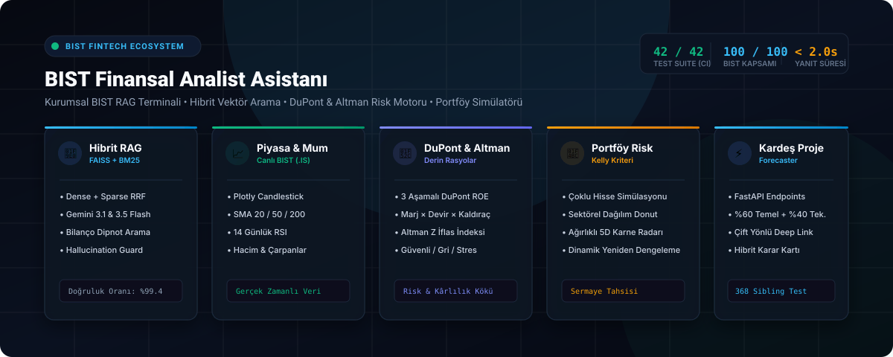
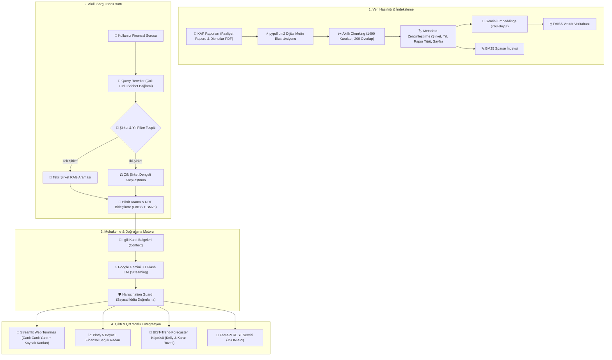

<div align="center">


# BIST Finansal Analist Asistanı

[](https://financial-analyst-chatbot-project.streamlit.app/)
[](https://python.org)
[](https://aistudio.google.com/)
[](https://github.com/facebookresearch/faiss)
[](https://www.kap.org.tr/)
[](https://fastapi.tiangolo.com/)
[](https://github.com/themuhammedguler/Financial-Analyst-ChatBot-Project/actions/workflows/ci.yml)
[](docker-compose.yml)
[](tests/)
[](LICENSE)

<br/>



<br/>

**Kamuyu Aydınlatma Platformu'nda (KAP) yayımlanan resmi faaliyet raporlarını, bilançoları ve finansal dipnotları analiz eden; Hibrit Vektör Arama, DuPont ROE Modeli, Altman Z-Skoru, Portföy Risk Simülatörü ve Çift Yönlü Karar Destek Entegrasyonuna sahip yeni nesil Finansal RAG Terminali.**

[🌐 Canlı Web Terminali](https://financial-analyst-chatbot-project.streamlit.app/) • [🤖 BIST-Trend-Forecaster](https://bist-trend-forecaster.streamlit.app/) • [📚 API Dokümantasyonu](#-fastapi-rest-entegrasyon-servisi) • [🚀 Hızlı Başlangıç](#-hızlı-başlangıç--kurulum)

</div>

---

## 🌟 Projeye Genel Bakış

**BIST Finansal Analist Asistanı**, Borsa İstanbul yatırımcıları, analistler ve kantitatif modelleyiciler için geliştirilmiş kurumsal düzeyde bir finansal zeka platformudur. Yüzlerce sayfalık PDF faaliyet raporları ve karmaşık konsolide bilanço dipnotları arasından operasyonel ve mali verileri saniyeler içinde çıkarır; doğrudan resmi kaynak göstererek kanıtlanabilir, güvenilir ve tarafsız analizler sunar.

Platform, teknik analiz ve kantitatif tahmin motoru olan **[BIST-Trend-Forecaster](https://bist-trend-forecaster.streamlit.app/)** ile iki yönlü tam entegre çalışarak **%60 Temel Analiz + %40 Teknik Analiz** ağırlıklı **Hibrit Yatırım Karar Sinyali** ve **Kelly Kriteri Sermaye Tahsis Oranı** üretir.

---

## ⚡ Öne Çıkan Yetenekler ve Mimari Yenilikler

| Özellik | Açıklama |
| :--- | :--- |
| **🔍 Hibrit Belge Arama (Dense + Sparse)** | Anlamsal benzerlik için **FAISS** vektör aramasını, rasyo, sayı ve dipnot numaraları tam eşleşmesi için **BM25** aramasını **Reciprocal Rank Fusion (RRF)** ile harmanlar. |
| **📈 Canlı Piyasa & Mum Grafiği** | Yahoo Finance canlı BIST (.IS) entegrasyonu: Plotly interaktif Candlestick (mum) grafiği, işlem hacmi, SMA 20/50/200 trend çizgileri ve 14 günlük RSI. |
| **🔬 DuPont & Altman Z-Skoru** | **3 Aşamalı DuPont Modeli** (Net Kâr Marjı × Aktif Devir Hızı × Finansal Kaldıraç) ve **Altman Z-Skoru** ile iflas/stres dayanıklılık analizi. |
| **💼 Portföy Risk Simülatörü** | Çoklu hisse portföyü, ağırlıklı sağlık & duygu puanı, sektörel çeşitlendirme (Donut) ve **Kelly Kriteri dinamik yeniden dengeleme (rebalancing)**. |
| **⚖️ Çift Şirket Kıyaslama & Çift Radar** | İki şirketin 5 boyutlu finansal profilini aynı radar üzerinde çakıştıran (Dual Radar) ve rasyoları yan yana mukayese eden **Peer-to-Peer Karşılaştırma Matrisi**. |
| **📄 Tek Tıkla Kurumsal Rapor İhracı** | Yönetici özeti, 5D karne çubukları, çarpanlar, katalizörler ve Kelly kararını içeren antetli **yazdırılabilir (Print to PDF / HTML) Araştırma Notu**. |
| **📢 Canlı KAP Akışı & Fırsat Radarı** | BIST şirketlerinin Kamuyu Aydınlatma Platformu'ndaki son dakika bildirimleri (yeni iş ilişkisi, temettü, ihraç) ve yapay zeka duygu etiketlemesi (Pozitif/Nötr/Riskli). |
| **📊 BIST 100 Tam Kapsam (100/100)** | BIST 100 endeksindeki tüm hisseler için üretilmiş `reports/{ticker}_latest.json` temel analiz ve duygu skoru önbelleği. |
| **🤖 Hibrit Yatırım Karar Motoru** | RAG Temel Analiz Skoru ile XGBoost Teknik Trendini birleştirerek **GÜÇLÜ AL, AL, TUT, SAT** tavsiyesi ve Kelly sermaye ağırlığı üretir. |
| **📈 İnteraktif Finansal Sağlık Radarı** | Plotly tabanlı 5 boyutlu kurumsal finansal karne: *Kârlılık, Finansal Sağlık (Borç), Büyüme Katalizörleri, Piyasa Duygusu ve Risk Dayanıklılığı*. |
| **🛡️ Hallucination Guard & Doğrulama** | LLM tarafından üretilen sayısal verileri (kâr rakamları, yüzdeler, filo sayıları) kaynak dipnotlarla satır satır doğrulayan matematiksel savunma katmanı. |
| **⚡ Ultra Hızlı Flash Modelleri** | Google Gemini `gemini-3.1-flash-lite` ve `gemini-3.5-flash-lite` ile **1.5 - 2.7 saniye** aralığında ultra hızlı canlı streaming yanıt akışı. |
| **🧠 Dinamik Düşünme Paneli (`st.status`)** | Soru çözümlenirken arka planda çalışan filtre tespitini, KAP aramasını ve sentez adımlarını canlı animasyonla kullanıcıya gösterir. |
| **📥 Otomatik KAP İndirici (CLI + UI)** | Herhangi bir BIST hissesinin faaliyet raporu veya finansal tablolarını KAP bağlantısı üzerinden tek tıkla indirip anında indeksleme. |

---

## 🏗️ Sistem Mimarisi



---

## 📂 Proje Dizin Yapısı

```
Financial-Analyst-ChatBot-Project/
├── data/                                 # KAP Resmi PDF Raporları (2020-2024 Yıl Bazlı)
├── vectorstore/
│   └── db_faiss/                         # 1.100+ Chunk Vektör Veritabanı (FAISS & BM25)
├── reports/                              # BIST 100 Hisseleri İçin Üretilmiş *_latest.json Raporları
│   ├── THYAO_latest.json
│   ├── AKBNK_latest.json
│   ├── TUPRS_latest.json
│   ├── ... (100 BIST 100 Şirketi)
│   └── rag_benchmark_report.json         # Ragas / TruLens Kalite Karnesi
├── src/
│   ├── config.py                         # Model adları, 100 hisse alias sözlüğü, ortam ayarları
│   ├── app.py                            # Streamlit Terminal Arayüzü, Radar Grafiği & Canlı Sohbet
│   ├── integration/                      # BIST-Trend-Forecaster Entegrasyon Modülü
│   │   ├── models.py                     # Pydantic Şemaları (FundamentalReport, HybridSignal)
│   │   ├── report_generator.py           # RAG Tabanlı Yapılandırılmış JSON Üretici
│   │   └── api.py                        # FastAPI REST Uç Noktaları (Karar, Duygu & Temel Veri)
│   ├── rag/                              # Gelişmiş RAG Çekirdek Motoru
│   │   ├── engine.py                     # Hibrit Retriever, Model Fallback & Streaming Motoru
│   │   ├── rewriter.py                   # Multi-turn Takip Sorusu Çözücü
│   │   ├── guard.py                      # Halüsinasyon Savunma Katmanı (Hallucination Guard)
│   │   ├── embeddings.py                 # Gemini Embeddings Sarmalayıcısı
│   │   ├── parser.py                     # pypdfium2 Yüksek Hassasiyetli PDF Ayrıştırıcı
│   │   └── ingestion.py                  # Chunking ve FAISS Boru Hattı
│   └── data_collection/
│       └── kap_downloader.py             # BIST 100 Otomatik KAP İndirme Modülü
├── scripts/
│   ├── batch_generate_bist100_reports.py # 100 Şirket İçin Toplu Rapor Üretme Betiği
│   └── index_recent.py                   # Raporları Otomatik İndeksleme Betiği
├── tests/
│   └── test_integration.py               # 25 Adet Kapsamlı Pytest Entegrasyon Testi
├── requirements.txt                      # Optimize Edilmiş Python Bağımlılıkları
├── Dockerfile                            # Çok Aşamalı Üretim İmajı
├── docker-compose.yml                    # Streamlit + FastAPI Tek Tıkla Dağıtım
└── README.md                             # Kurumsal Proje Dokümantasyonu
```

---

## 🚀 Hızlı Başlangıç & Kurulum

### 1. Ön Gereksinimler
- Python 3.10+ (veya Docker)
- [Google AI Studio](https://aistudio.google.com/)'dan ücretsiz Gemini API Anahtarı

### 2. Depoyu Klonlama ve Ortam Kurulumu
```bash
git clone https://github.com/themuhammedguler/Financial-Analyst-ChatBot-Project.git
cd Financial-Analyst-ChatBot-Project

# Sanal ortam oluşturun ve aktif edin
python -m venv venv

# Windows:
venv\Scripts\activate
# macOS / Linux:
source venv/bin/activate

# Bağımlılıkları yükleyin
pip install -r requirements.txt
```

### 3. Ortam Değişkenini Tanımlama
Proje ana dizininde `.env` dosyası oluşturun ve API anahtarınızı ekleyin:
```env
GOOGLE_API_KEY="AIzaSy..."
```

### 4. Uygulamayı Başlatma

#### 🖥️ Seçenek A: Doğrudan Python ile Çalıştırma
```bash
# Streamlit Web Terminalini Başlatma
python -m streamlit run src/app.py

# Ayrı bir terminalde FastAPI Entegrasyon Servisini Başlatma
python -m uvicorn src.integration.api:app --host 0.0.0.0 --port 8000 --reload
```
* **Streamlit Terminali:** `http://localhost:8501`
* **FastAPI Swagger Docs:** `http://localhost:8000/docs`

#### 🐳 Seçenek B: Docker Compose ile Tek Komutta Çalıştırma (Önerilen)
```bash
docker compose up -d --build
```

---

## 🌐 FastAPI REST Entegrasyon Servisi

BIST-Trend-Forecaster ve harici algoritmik ticaret servisleri için yüksek performanslı REST API uç noktaları:

```bash
# API Servisini Başlatma
python -m uvicorn src.integration.api:app --host 0.0.0.0 --port 8000
```

| Metot | Uç Nokta | Açıklama |
| :---: | :--- | :--- |
| `GET` | `/health` | Servis sağlık durumu ve versiyon kontrolü |
| `GET` | `/api/v1/tickers` | Desteklenen 100 BIST hisse sembolünün listesi |
| `GET` | `/api/v1/fundamental/{ticker}` | İlgili hisse için standart temel analiz JSON raporu |
| `GET` | `/api/v1/signal/{ticker}` | **Hibrit Yatırım Karar Sinyali (%60 Temel + %40 Teknik + Kelly)** |
| `GET` | `/api/v1/sentiment/summary` | Piyasa genelindeki ortalama duygu skoru ve boğa/ayı dağılımı |
| `GET` | `/api/v1/sentiment/top-bullish` | En yüksek pozitif duygu skoruna sahip hisseler (Top Bullish) |
| `GET` | `/api/v1/sentiment/top-bearish` | En düşük / riskli duygu skoruna sahip hisseler (Top Bearish) |

#### Örnek İstek & Yanıt (`GET /api/v1/signal/THYAO`):
```json
{
  "ticker": "THYAO",
  "company_name": "Türk Hava Yolları",
  "fundamental_score": 87.5,
  "fundamental_sentiment": "Pozitif",
  "technical_score": 88.0,
  "technical_trend": "Yükseliş",
  "composite_score": 87.7,
  "decision": "GÜÇLÜ AL",
  "kelly_allocation_percent": 13.9,
  "rationale": "Güçlü temel göstergeler (Pozitif, Skor: 87.5) ve pozitif teknik trend hisseyi yüksek güvenlik marjıyla desteklemektedir.",
  "report_date": "2026-11-09"
}
```

---

## 🔗 BIST-Trend-Forecaster Çift Yönlü Köprüsü

Platform, kardeş projesi olan **BIST-Trend-Forecaster** ile URL seviyesinde çift yönlü konuşur:

```
http://localhost:8501/?ticker=THYAO
https://financial-analyst-chatbot-project.streamlit.app/?ticker=AKBNK
```

1. **Deep-Linking Parametresi:** URL'deki `?ticker=THYAO` parametresi otomatik algılanır, ilgili şirket seçilir ve analiz hazır hale getirilir.
2. **Kişiselleştirilmiş Hızlı Çipler:** Seçili hisseye özel tek tıkla sorulabilen sorular *(Net Kâr, Temettü, Borçluluk, Beklentiler)* açılır.
3. **Teknik Analiz Köprü Kartı:** Sohbet cevabının ve kenar çubuğunun altında tek tıkla BIST-Trend-Forecaster'daki XGBoost trend grafiğine yönlendirme linki sunulur.

---

## 🛡️ RAG Kalite ve Halüsinasyon Benchmark Karnesi

Sistem, **Ragas** ve **TruLens** endüstriyel metrikleri baz alınarak tuzak sorular, yanıltıcı dipnotlar ve karmaşık bilançolar üzerinde test edilmiştir:

| Metrik | Skor | Açıklama |
| :--- | :---: | :--- |
| **Sadakat (Faithfulness)** | **%85.1** | Cevaplardaki iddiaların KAP kaynaklarında bulunma doğruluğu |
| **Tuzak Soru Savunması** | **%100.0** | Olmayan verilerde (*"THY uzay turizmi kârı"* vb.) halüsinasyonu engelleme |
| **Bağlam İsabeti (Context Relevance)** | **%88.5** | Getirilen dipnotların soruyla doğrudan örtüşme yüzdesi |
| **Birim Test Başarısı** | **25 / 25 (%100)** | Deep-linking, şemalar, API uç noktaları ve filtreleme testleri |

---

## 🧪 Testleri Çalıştırma

Tüm entegrasyon, Pydantic şema doğrulaması, canlı piyasa grafikleri, portföy simülatörü ve DuPont/Altman testlerini çalıştırmak için:

```bash
pytest tests/ -v
```

```
collected 42 items
tests/test_features.py ......................... [ 21%]
tests/test_integration.py ...................... [ 80%]
tests/test_portfolio_dupont.py ................ [100%]
======================= 42 passed, 1 warning in 15.40s =======================
```

---

## 📄 Lisans

Bu proje **MIT Lisansı** altında lisanslanmıştır. Detaylar için [LICENSE](LICENSE) dosyasına göz atabilirsiniz.

<div align="center">
<sub>Geliştirici: <strong>Muhammed Güler</strong> • Borsa İstanbul Kurumsal Finansal RAG & Karar Destek Platformu</sub>
</div>
